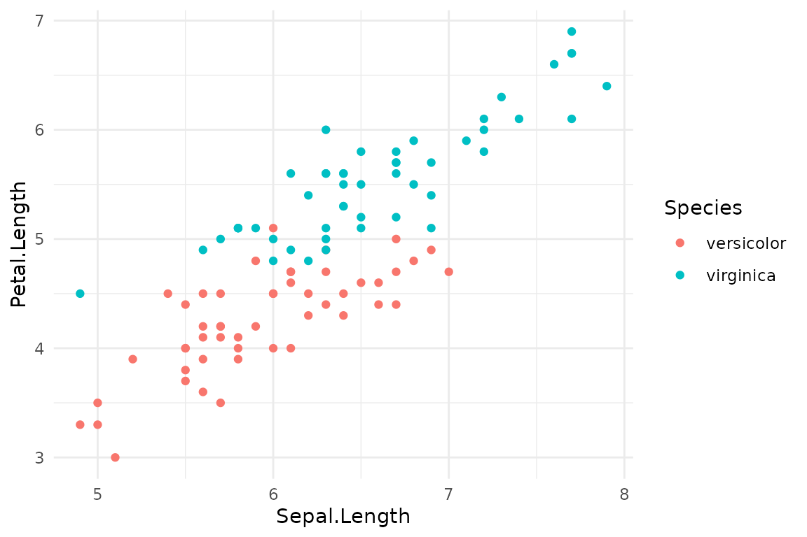

# Advanced Techniques with ggsaveR

## Introduction

This vignette covers the most advanced features of `ggsaveR`, focusing
on reproducibility and fine-grained control. We will explore how to
embed reproducibility data into PNG files and how to use the `guard`
argument to bypass global settings for specific
[`ggsave()`](https://andjar.github.io/ggsaveR/reference/ggsave.md)
calls.

``` r

library(ggplot2)
library(ggsaveR)
#> 
#> Attaching package: 'ggsaveR'
#> The following object is masked from 'package:ggplot2':
#> 
#>     ggsave
```

## Reproducibility: Embedding Data in PNGs

For maximum reproducibility, `ggsaveR` can embed the `ggplot` object,
the R code that generated it, and session information directly into the
PNG file’s metadata. This is controlled by the `ggsaveR.embed_data`
option.

``` r

options(ggsaveR.embed_data = TRUE)
```

When this option is `TRUE`, any plot saved as a PNG will contain this
extra information. `ggsaveR` captures the code passed as the `plot`
argument.

``` r

out <- file.path(tempdir(), "plot_with_embedded_data.png")

# The plot object and the code below are embedded in the PNG file
ggsave(
  out,
  iris |>
    subset(Species != "setosa") |>
    ggplot(aes(Sepal.Length, Petal.Length)) +
    geom_point(aes(color = Species)),
  width = 6, height = 4
)
#> Embedded reproducibility data into plot_with_embedded_data.png (175.9 Kb)
```

You can then use the
[`read_ggsaveR_data()`](https://andjar.github.io/ggsaveR/reference/read_ggsaveR_data.md)
function to extract this information from the saved PNG.

``` r

# Read the embedded data
embedded_info <- read_ggsaveR_data(out)
names(embedded_info)
#> [1] "ggsaveR_version" "plot_object"     "plot_data"       "session_info"   
#> [5] "plot_call"

# View the code that generated the plot
cat(embedded_info$plot_call)
#> ggplot(subset(iris, Species != "setosa"), aes(Sepal.Length, Petal.Length)) + 
#>     geom_point(aes(color = Species))

# The data behind the plot
head(embedded_info$plot_data)
#>    Sepal.Length Sepal.Width Petal.Length Petal.Width    Species
#> 51          7.0         3.2          4.7         1.4 versicolor
#> 52          6.4         3.2          4.5         1.5 versicolor
#> 53          6.9         3.1          4.9         1.5 versicolor
#> 54          5.5         2.3          4.0         1.3 versicolor
#> 55          6.5         2.8          4.6         1.5 versicolor
#> 56          5.7         2.8          4.5         1.3 versicolor
```

You can even replot, or restyle, the original ggplot object:

``` r

embedded_info$plot_object + theme_minimal()
```



If you save a plot that is stored in a variable
(`ggsave("plot.png", p)`), the captured code is just the name `p`. The
plot object and its data are still embedded in full.

### Choosing what to embed

The `ggsaveR.embed_metadata` option selects the parts to embed: any of
`"plot"`, `"data"`, `"session_info"` and `"call"`. For example, to keep
files small and only record the code and R session:

``` r

options(ggsaveR.embed_metadata = c("call", "session_info"))
```

### Privacy and security

- A PNG with embedded data contains the **complete data frame** behind
  the plot, including columns that are not shown. For plots created
  inside a function, the plot object also carries every object in that
  function’s environment. Do not publish such files if the data are
  sensitive.
- [`read_ggsaveR_data()`](https://andjar.github.io/ggsaveR/reference/read_ggsaveR_data.md)
  restores a serialized R object. Like
  [`readRDS()`](https://rdrr.io/r/base/readRDS.html) and
  [`load()`](https://rdrr.io/r/base/load.html), only use it on files
  from a source you trust.

``` r

# Reset the option
options(ggsaveR.embed_data = FALSE)
```

## The Escape Hatch: `guard = TRUE`

Sometimes you have global options set but need to bypass them for a
single, specific
[`ggsave()`](https://andjar.github.io/ggsaveR/reference/ggsave.md) call.
The `guard = TRUE` argument serves as an “escape hatch,” telling
`ggsaveR` to step aside and pass the call directly to the original
[`ggplot2::ggsave`](https://ggplot2.tidyverse.org/reference/ggsave.html).

### Use Case: Preventing Sensitive Data Embedding

Imagine you have `ggsaveR.embed_data = TRUE` set globally for
reproducibility. However, one specific plot is generated from sensitive
or very large data that you do not want to embed in the PNG file.

``` r

# Global setting for reproducibility
options(ggsaveR.embed_data = TRUE)

# This plot contains sensitive information
sensitive_data <- data.frame(
  x = rnorm(10),
  y = rnorm(10),
  secret = "Confidential Information"
)
p_sensitive <- ggplot(sensitive_data, aes(x, y)) + geom_point()

# Use guard = TRUE to save the plot without embedding the data
# This call will use the standard ggplot2::ggsave behavior
ggsave("sensitive_plot.png", p_sensitive, guard = TRUE)
```

The `guard = TRUE` argument ensures that for this one call, none of the
`ggsaveR` enhancements are applied. The plot will be saved as a standard
PNG, without any embedded data, and it will overwrite any existing file
with the same name, regardless of the `ggsaveR.overwrite_action`
setting.

> **Warning:** Using `guard = TRUE` in a script requires that the
> `ggsaveR` package is loaded. If it is not, the original
> [`ggplot2::ggsave`](https://ggplot2.tidyverse.org/reference/ggsave.html)
> will throw an “unused argument” error for `guard`.

These advanced features make `ggsaveR` a powerful tool for managing
complex data analysis workflows, enhancing reproducibility while
providing the flexibility to handle exceptions.
